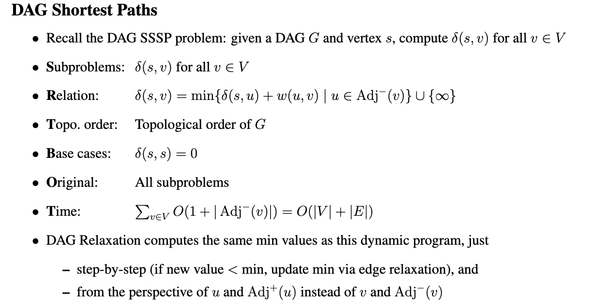
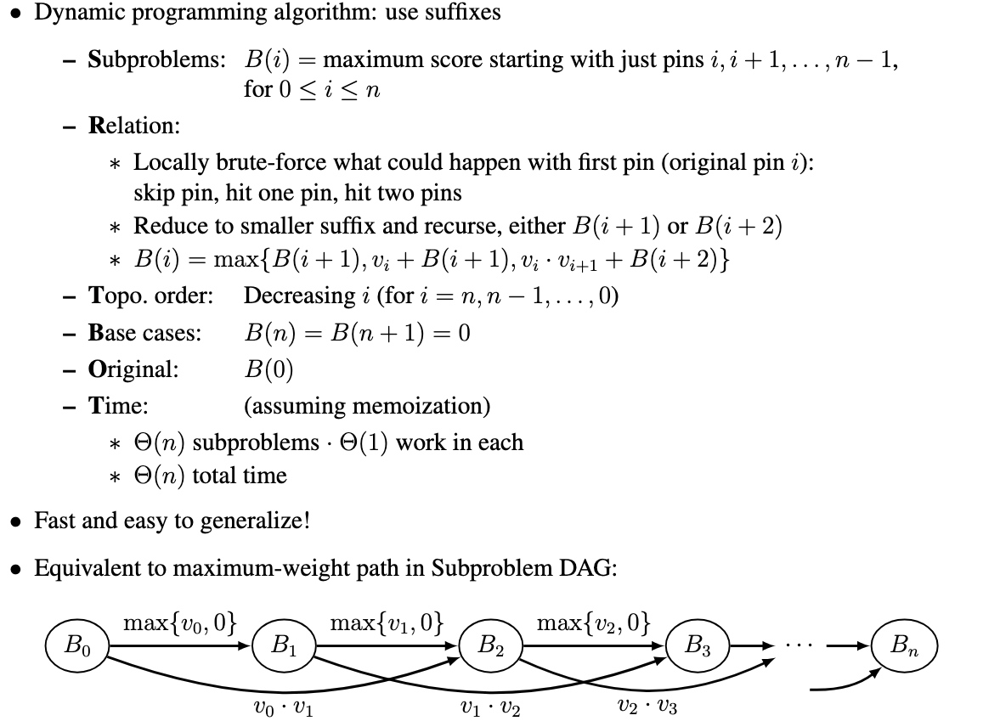

---
tags:
- dynamic-programming
- topological
title: Dynamic Programming
---
!!! links
    - [hello-algo](https://www.hello-algo.com/chapter_dynamic_programming/)
    - MIT 6.006（2020） [Introduction to Algorithms](https://ocw.mit.edu/courses/6-006-introduction-to-algorithms-spring-2020/) lecture 15-18

## Def {#def}
简单来说，动态规划先定义足以描述子问题的状态，再建立状态之间的依赖关系，最后让每个需要的状态只计算一次。

!!! quote "@hello-algo"
    - 分治算法递归地将原问题划分为多个相互独立的子问题，直至最小子问题，并在回溯中合并子问题的解，最终得到原问题的解。
    - 动态规划也对问题进行递归分解，但与分治算法的主要区别是，动态规划中的子问题是相互依赖的，在分解过程中会出现许多重叠子问题。
    - 回溯算法在尝试和回退中穷举所有可能的解，并通过剪枝避免不必要的搜索分支。原问题的解由一系列决策步骤构成，我们可以将每个决策步骤之前的子序列看作一个子问题。

一个更有洞察力的观点是，将recursive algorithm的方法与graph的拓扑结构联系起来

| Class               | Graph                |
| ------------------- | -------------------- |
| Brute Force         | Star                 |
| Decrease & Conquer  | Chain                |
| Divide & Conquer    | Tree                 |
| Dynamic Programming | DAG，in-degree > 1    |
| Greedy              | Incremental Subgraph |

关于dp,有两种实现方式：

- Top down: record subproblem solutions in a memo and re-use(recursion + memoization)
- Bottom up: solve subproblems in topological sort order (usually via loops)

解题时可以分析具体例子，思考最小子问题是什么，再写出状态转移方程，然后是边界情况的定义
当然，在下面我们会给出一个更加结构化的思考例子

## SRT BOT {#srt-bot}

!!! quote "@MIT"
    How to solve a problem recursively (SRT BOT)
    1. Subproblem definition
    2. Relate subproblem solutions recursively
    3. Topological order on subproblems (⇒ subproblem DAG)
    4. Base cases of relation
    5. Original problem solution via subproblem(s)
    6. Time analysis

###  Subproblem definition and relation {#subproblem-definition-and-relation}
定义子问题的方式很大程度上取决于它们的依赖关系，若是前面状态依赖于后面状态，通常使用`suffix`

!!! example

    $$
    x(i)=\text{用剩余牌 }(c_i,\ldots,c_n)\text{，最多还能赢多少局}
    $$

### Topological order {#topological-order}
采用bottom-up方式时，需要找到根节点，即入度为0的结点，为什么存在？因为如果没有，那么顺着一个节点往回推，一定会走完所有的结点，就形成环了，矛盾。
大多数情况下，子问题的偏序关系是和i一致的，如果偏序关系是复杂的，那么可以[拓扑排序](../FDS-ZJU/notes/%E5%9B%BE.md#%E6%8B%93%E6%89%91%E6%8E%92%E5%BA%8F)
### Time analysis {#time-analysis}

总时间为：

  $$
  \sum_{x\in X}\operatorname{work}(x)
  $$

  若对所有 $x\in X$，都有 $\operatorname{work}(x)=O(W)$，则总时间为：

  $$
  |X|\cdot O(W)
  $$

---
下面举几个🌰

### DAG Shortest Paths {#dag-shortest-paths}

我们会发现，这和在FDS中学的松弛操作得出的结果一样，[带权图](../FDS-ZJU/notes/%E5%9B%BE.md#%E5%B8%A6%E6%9D%83%E5%9B%BE)

在我看来，它可以代表dp中的一种递推形式，状态转移方程中每个比较项只有一个子问题，在下一个🌰中便可窥见一二

$$
F(s)=\min_{t\in \mathrm{Next}(s)}
\{c(s,t)+F(t)\}
$$

### Bowling {#bowling}
大致意思是：保龄球分数为所有打倒的分数乘积之和。

发现，它实质上就是换了边权的一个DAG最短路径问题，也就是上个例子是这一类问题的`meta problem`

建立子问题之间的关联，实际上相比于全局的暴力枚举，归约的本质是局部的枚举，只不过需要的结果其他子问题已经给出。“提高的关键在于：该问题可能的答案数量应较少（呈多项式级），从而确保穷举过程的开销不会过大。”

## 空间优化 {#空间优化}
可以观察dp表，新数据从哪里来的？我们就可以将dp表优化成一位，将新数据覆盖旧数据，可以结合：正序、倒序、临时变量

一些经典的问题，都在hello-algo中有详细说明：

- 0-1背包问题
- 完全背包问题
- 编辑距离问题
