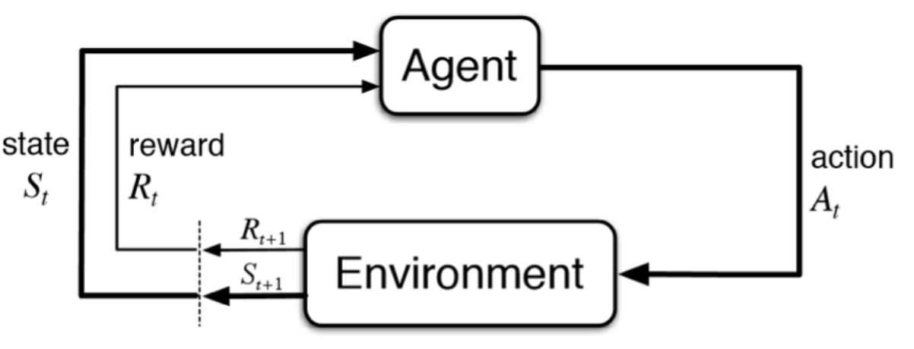
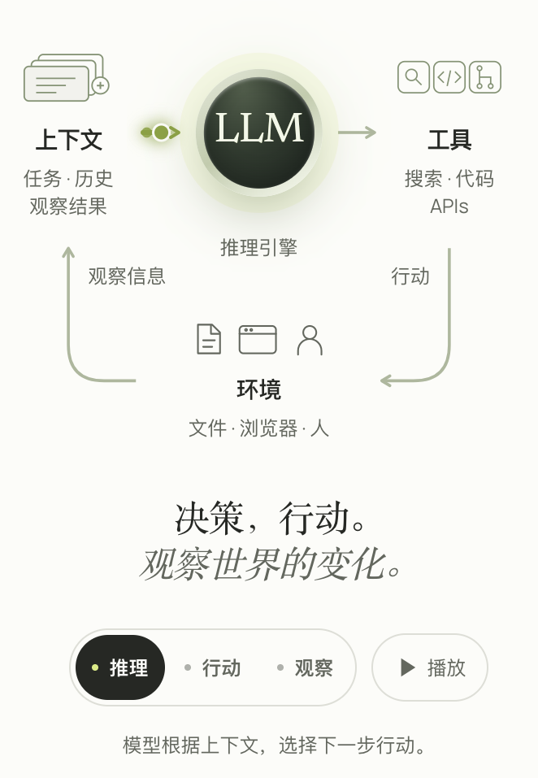
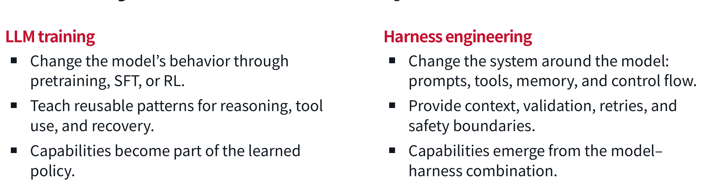
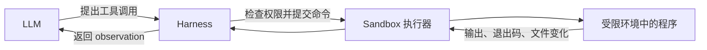

---
tags:
- harness
- agent
title: 'Course Overview: What Is an Agent?'
---
# Course Overview: What Is an Agent? {#course-overview-what-is-an-agent}

[watch on youtube](https://www.youtube.com/watch?v=UwfjzyLnvMg&list=PLSN0qpDfUvTM&index=1)
[slides](https://www.cmu-agents.com/slides/lecture-01-agents.pdf)


!!! important "Readings"
    - [x] [Toolformer](https://arxiv.org/abs/2210.03629) ✅ 2026-10-20
    - [ ] [ReAct](https://arxiv.org/abs/2210.03629)


## How capable are (current) agents? {#how-capable-are-current-agents}

研究人员通过agents完成了一个C语言的编译器:[github](https://github.com/anthropics/claudes-c-compiler/tree/main) [项目说明](https://www.anthropic.com/engineering/building-c-compiler)。
这个项目采用multi-agent运行模式，16个独立agent各自在Docker中运行，利用git防止冲突，根据进度文件恢复上下文，通过循环持续工作，人类研究员测试引导。
```bash
while true; do
    COMMIT=$(git rev-parse --short=6 HEAD)
    LOGFILE="agent_logs/agent_${COMMIT}.log"

    claude --dangerously-skip-permissions \
           -p "$(cat AGENT_PROMPT.md)" \
           --model claude-opus-X-Y &> "$LOGFILE"
done
```

这只是快半年前agent的能力，所以我在标题中把current打了个括号，agent的能力边界还在不断扩展。要思考这件问题，可以想想最开始，agent基于它的理想定义，可以帮我们干什么？一个稍微有些大而空的答案是：通过观察环境然后采取行动的任务，agent都可以完成；这和之后agent的基本框架有点像。这其中不免有种种问题无法完全由agent处理，Daniel将任务类型分成三种：autonomous；asking first； never

## What is an agent? {#what-is-an-agent}



agent是LLM+Harness，在一个loop中与environment交互。而harness包括tool和context



上图截取自[agent-in-depth](https://bojieli.github.io/ai-agent-book/astro/)

下面我们通过一个极简的agent项目来理解[mini-swe-agent](https://github.com/swe-agent/mini-swe-agent)。

先看[hello_world.py](https://github.com/SWE-agent/mini-swe-agent/blob/main/src/minisweagent/run/hello_world.py)，这段代码展示了agent是如何被组装的，换句话说，就是如何启动一个最小的agent。`LitellmModel`里面向agent传递了模型信息，工具的定义，提示词。`LocalEnvironment`顾名思义，传递tool call在本机运行的真实结果。

```python
	agent = DefaultAgent(
        LitellmModel(model_name=model_name),
        LocalEnvironment(),
        **yaml.safe_load(Path(package_dir / "config" / "default.yaml").read_text())["agent"],
    )
    agent.run(task)
    return agent
```

组装完毕后，通过`run`内部，可以进入loop了，具体代码在[这](https://github.com/SWE-agent/mini-swe-agent/blob/main/src/minisweagent/agents/default.py)。~~虽然只有不到200行，不过我还是没完全看~~，省略异常处理和保存逻辑后，可以得到以下简化的核心流程

```python

def step(self):
    return self.execute_actions(self.query())
    
while True:
    self.step()

    if self.messages[-1].get("role") == "exit":
        break
```

- `query()`：把当前消息历史发给模型，得到下一步动作。
- `execute_actions()`：执行动作，把结果追加到消息历史。

还有一个值得说的，就是组装过程中加载的默认配置[default.py](https://github.com/SWE-agent/mini-swe-agent/blob/main/src/minisweagent/config/default.yaml)，我们很容易~~用gpt~~理解其中的结构

```yaml
agent:
  system_template: |        # 全局行为与动作格式
    ...
  instance_template: |      # 当前任务与工作指导
    ...
  step_limit: 0             # 步数限制
  cost_limit: 0.            # 成本限制

environment:
  env:                      # 执行命令时的环境变量
    ...

model:
  observation_template: |   # 命令结果怎样展示给模型
    ...
  model_kwargs:             # 模型 API 参数
    ...
  format_error_template: |  # 输出格式错误时的反馈
    ...
```

观察template，`<...>`这种xml格式经常出现，正好印证了我之前看的agentbook的观点，[详细看这里](https://bojieli.github.io/ai-agent-book/astro/book/chapter2/#%E7%BB%93%E6%9E%84%E5%8C%96%E6%8F%90%E7%A4%BA%E7%B3%BB%E7%BB%9F%E6%8F%90%E7%A4%BA%E8%AF%8D%E7%9A%84%E6%A0%BC%E5%BC%8F)：由于LLM本身的训练数据包含大量结构化内容，XML标签在层次化格式的同时，本身就带有语义信息，比文本语言更容易理解。


!!! quote
    - **Markdown 的作用**：`#`、`##` 这些标题让人类一眼看出层次结构，可读性好。
    - **XML 的作用**：`<file_operation>`、`<network_request>` 这些标签告诉模型“这个块是关于文件操作的”、“这个块是关于网络请求的”，语义精确，模型处理起来更准确。


从配置中我们亦可以理解trajectory怎么构成，如果你想可视化地看到它是如何一步步构建的，你可以访问[这个仓库](https://docent.transluce.org/dashboard/a4844da1-fbb9-4d61-b82c-f46e471f748a/agent_run/009b8af3-bf9b-40cc-9f47-2bb45aee0209?transcript_id=f40bd2c6-4b55-4749-9c77-29312e87af0d&block_idx=109)

😘以上就是我对这个项目主干结构的解读，~~哪天有空跑一下，据说它的agent框架的bechmark优于codex和claude(?~~

可以在[这个平台](https://www.swebench.com/)上看到各个agent在不同模型上的表现，你甚至可以评测自己的agent框架

## Agent capabilities {#agent-capabilities}

当我们谈论agent capabilities时，我们在谈论什么？——你用agent会遇到哪些问题？

我们在谈论
1. Accurate tool calling 
2. Coherence over long context
3. Customizability 
4.  Complex task management
5. Environment understanding 
6.  Safety


给出了两条提升agent的路线：LLM training和harness engineering



这就会引出一个很有趣的讨论——两者哪个对agent的表现影响更大


!!! idea
    agent-book中的大致直觉是“模型决定上限，harness 释放能力”，但这似乎太过绝对。查找了一些前沿的观点后，brainstorm出了一些想法
    - 通过消融实验，一个harness组件代表这LLM不具有的一个能力，所以，模型变强后，部分 harness 会过时，但新的任务边界又需要新的 harness。

    - 实验表明，更复杂、甚至厂商原生的 harness，也不保证正确率更高。

    - agent-in-depth提出一些harness可以融入模型训练，实际上很多著名模型也是这么做的。因为Training 能改善完整的行动策略，而不只是回答质量。

    - **一个很新的方向：让 harness 本身从经验中学习。**[Growing Harness 论文](https://arxiv.org/html/2609.26760v2) 这就引出了另一个问题，经验也许可以保存在可执行程序中(再insane一些，保存在微调权重中？？


我们把问题拉回来些，Graham给出了他的解答，既然agent的表现是多方面的，现在我们可以用不同 的方法提升不同方面的表现

两种方法在6大方面的应用在PPT20-25都讲了，像一个大纲一样罗列了出来，就不具体展开了

### How agent behavior is trained {#how-agent-behavior-is-trained}

1. **Pretraining**
2. **Mid-training / SFT**：可以理解为用示范教模型怎么做，比如看到某种报错后应该检查什么、tool call应该是什么格式。
3. **RL**：通过reward或preference改进行为，关注整个trajectory中的决策，而不只是单条回复长得像不像示范。

前面提到的[Toolformer](https://arxiv.org/abs/2302.04761)就可以联系到这里：模型先提出候选API calls，训练流程根据它们是否帮助预测后续token来筛选，再用增强后的文本微调模型。


## Agent engineering {#agent-engineering}

==下面也是类似于大纲的东西，由codex辅助生成🥹🥹==

### Harness engineering {#harness-engineering}

Harness负责管理state、tools、memory和control flow，验证动作、处理错误，以及落实permissions和安全边界。

### Sandbox {#sandbox}

Sandbox负责隔离代码和tool execution，限制compute、network和filesystem access，并提供可复现的运行环境。比如Docker



### LM inference {#lm-inference}

LM inference负责可靠地提供模型生成服务，包括batch requests、复用KV cache，以及管理streaming、parallelism和throughput。比如vLLM和SGLang。

### Training systems {#training-systems}

准备数据、收集rollouts、协调distributed workers，以及checkpoint、evaluation和复现实验。

Rollout就是让agent在environment中实际走一段交互，得到行动和观察组成的trajectory。这些轨迹及其reward可以成为训练数据，推动模型参数更新。

### Observability and monitoring {#observability-and-monitoring}

记录traces和metrics，跟踪quality、cost、failures，比较不同trajectory和evaluation。
