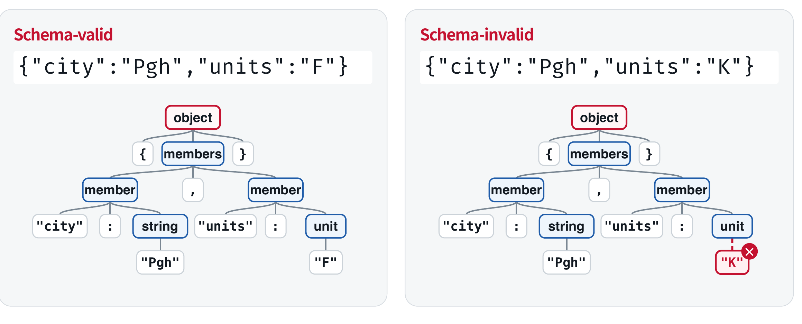
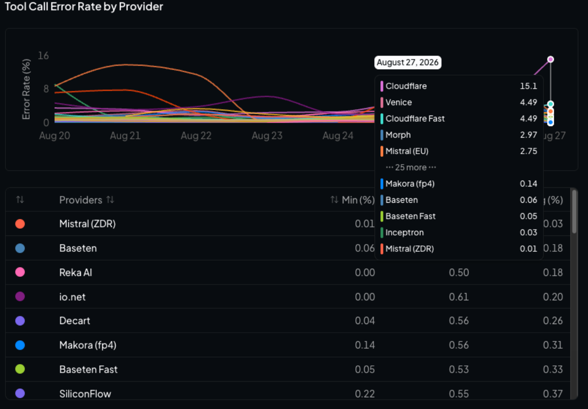

---
tags:
- agent
- API
- tool-call
- MCP
title: 'Agent Capabilities 1: Tool Use'
---
# Agent Capabilities 1: Tool Use {#agent-capabilities-1-tool-use}


!!! workflow
    由于一些内容是方法论或是简单易懂的例子，而且过于结构化的笔记对于阅读和写作的时间成本消耗过大，所以我会跳过一些内容(它们在PPT中有完整的呈现!)，更专注于写一些interesting或是让我启发的东西。另外，由于不是结构化的内容，文章的标题也不是完全并列的关系，而是一些小专题的感觉🥳


> A tool is an interface through which a language model can invoke
an external computer program.

## Code as a meta tool {#code-as-a-meta-tool}

> Code composes control flow, libraries, and multiple operations in one action.


如果读者经常使用agent工具，在思考链中，不难注意到，包含很多`python ...`的调用。code是**串联多个tool的工具**；如果我们把API的定义广义化，把它理解为程序的接口(如果这样理解，就和tool的 定义非常重合了)，code能力就是将这些接口返回的结果串在一起，但它只是提供接口。


这样看来，code好像无所不能。在这些情况，没有用到code，假设：1.agent需要读取文件 2.数`strawberry`中的字母数量，这两类例子好像有点特殊。笔者一个自己的直觉(~~奇奇怪怪~~)想法，`code`和`language`是LLM的两种母语，所以在tool call时不需要“转译”。前者获取的文本可以直接作为输入，而后者在code的过程中已经自然地将单词嵌入代码中。

实验证明，`code`比`JSON`和`Text`表现更好

为什么是python? 它拥有更多的库、更好的编排方式。。。


!!! question
    在训练LLM时，我发现我更关注文本的训练，专注于coding的模型好像被我忽略了


## structure {#structure}

def `in`

```json
weather_tool = {
    "type": "function",
    "function": {
        "name": "get_weather",
        "parameters": {
            "type": "object",
            "properties": {
                "city": {
                    "type": "string"
                }
            },
            "required": ["city"]
        }
    }
}
```

判断JSON是否合法就像一棵树可以展开


API request `out`
```json
response = client.chat.completions.create(
    model=model,
    messages=messages,
    tools=[weather_tool],
)
```


!!! idea
    why JSON? 试试XML YAML...


```text
API request
    ↓ chat template
带角色、工具说明和边界标记的序列
    ↓ tokenizer
token IDs
    ↓ grammar check、model
new token IDs
    ↓ decode + tool-call parser
结构化工具调用
    ↓ 参数验证 + 分派
真正执行函数
```

如何保证new token包含合法的tool call，请阅读XGrammar

## REST API Calling {#rest-api-calling}
[REST API](https://fastapi.tiangolo.com/tutorial/first-steps/#openapi)
这一节讲的是如何将一个函数变成一个可以通过网络调用、并能被 agent 使用的服务

通过一个网络接口
```python
@app.get("/weather", operation_id="get_weather")
def weather(
    city: str,
    key: Annotated[str, Security(key_header)],
    units: Literal["C", "F"] = "F",
) -> Weather:
    verify(key)
    return get_weather(city, units)
```

它把这个 HTTP 请求映射到了 Python 函数
```http
GET /weather?city=Pittsburgh&units=F
X-API-Key: 调用者的密钥
```

coding agent可以直接用curl发请求
值得注意的是，它实际属于bash的tool call，而不是weather
==这又体现了 code as a meta-tool：只暴露 Bash 这样的通用执行工具==
```bash
curl -sS -G https://weather.example/weather \
  --data-urlencode "city=Pittsburgh" \
  --data-urlencode "units=F" \
  -H "X-API-Key: $WEATHER_API_KEY"
```

==这有点难以理解，weather的URL实际上来自接口文档或是其他来源，所以可能实际工程中根本没有get_weather这种工具类型==

## MCP {#mcp}
MCP 标准规定了工具发现和调用的协议，把服务细节封装在服务器后面，通过统一协议接入[MCP official](https://modelcontextprotocol.io/docs/2026-07-28/learn/architecture)

[REST MCP](https://gofastmcp.com/integrations/openapi)


def
```python
mcp = FastMCP.from_openapi(
    openapi_spec=spec,
    client=httpx2.AsyncClient(
        base_url="https://weather.example"
    ),
    name="Weather MCP",
)
```

FastMCP 根据这些信息建立映射：

```text
MCP 工具：
get_weather(city, units)
         ↓
HTTP 操作：
GET /weather?city=...&units=...
```

客户端先连接 MCP 服务，并提供自己的 MCP 凭据：

```python
async with Client(
    "https://mcp.example/mcp",
    auth=os.environ["MCP_API_KEY"],
) as client:
    tools = await client.list_tools()

    result = await client.call_tool(
        "get_weather",
        {"city": "Pittsburgh", "units": "F"},
    )
```

## Parallel {#parallel}


!!! idea
    建立tool calls的偏序关系(？😇


## Evaluating {#evaluating}


不同provider的error rate不同？

- 约束解码的方式
- 推测解码不同，是否用其他模型预测(Graham也质疑，这时是否还适合称为“同一个模型”🤣
- 参数量化方式，`FP16`表示每个数使用`16bit`
