---
tags:
- long-context
- attention
- positional-encoding
- inference
- context-management
title: 'Agent Capabilities 2: Context Management'
---
# Agent Capabilities 2: Context Management {#agent-capabilities-2-context-management}

!!! summary
    Graham ：今天讲的大部分是通用的 LLM 系统知识；但长上下文对 agent 格外关键，而先修课往往讲不透。所以本讲不是“agent 技巧合集”，而是**把 agent 循环放进推理系统的成本模型里重新看一遍**。

## Growth {#growth}
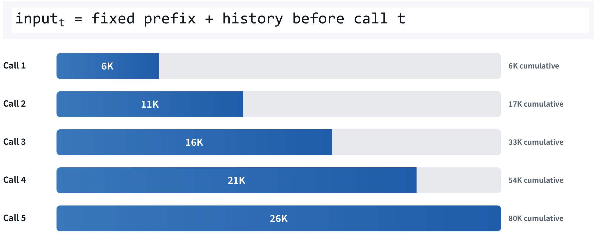
由于每次发送请求的对话token数以二次方的速度增长，我们有必要进行上下文管理。

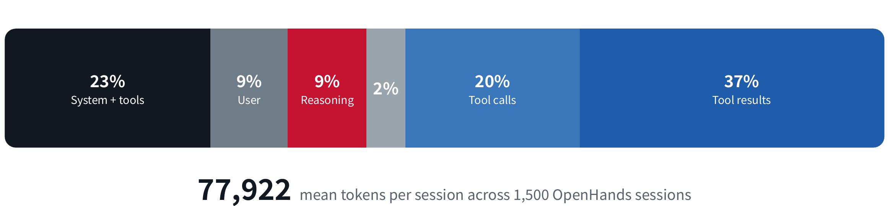

 几个观察：
 - `user`的部分占到及其少，其余大部分是agent自己生成的，信息密度低，而且有很多都不能复用
 - `system prompt`是一个固定的前缀，我们后面设计缓存时要重点考虑

Capacity：模型能不能用上需要的证据？决定因素包括架构、位置编码、训练数据的长度分布

Efficiency：系统付不付得起？要看注意力复杂度、KV 内存、缓存命中与压缩策略。

## Inference {#inference}

先看看云端的推理是如何进行的
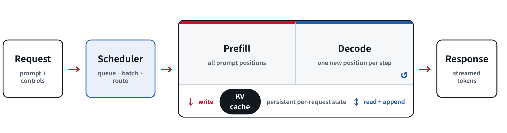

scheduler作为调度器安排推理，当服务器收到很多请求时，需要决定：
- queue:哪些请求需要等待
- batch:哪些请求合并在一起计算
- route:把请求分配给哪些计算资源

进入推理，先prefill，把需要的key和value存入KV cache，然后decode逐步生成下一个token，流式传输给response

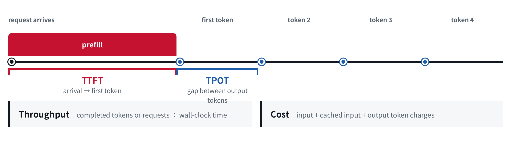
服务系统有四个常用指标：**TTFT**（从请求到第一个 token，主要由 prefill 决定）、**TPOT**（相邻输出 token 的间隔，主要由 decode 决定）、**throughput**（单位墙钟时间完成的 token 或请求数）、**cost**（输入 + 缓存输入 + 输出的计费）。

## attention {#attention}
如果想我们训练深度学习课程中模型那样，使用全局注意力，第n个token的时间复杂度是$O(N^2)$的，这不太可能实现。想到两种方法：**给每一步的比较次数加一个常数上界**，把 $O(N^2)$ 压到 $O(wN)$。区别只在于这个上界是“局部的窗口”，还是“选出来的子集”。

前沿模型的做法是，连续若干层做廉价的地方性计算，然后插一层昂贵的全局计算，再回到地方性计算。

下面我就来捋一捋各种”注意力们“，前方大量math袭来🥲🥲

### Softmax attention {#softmax-attention}
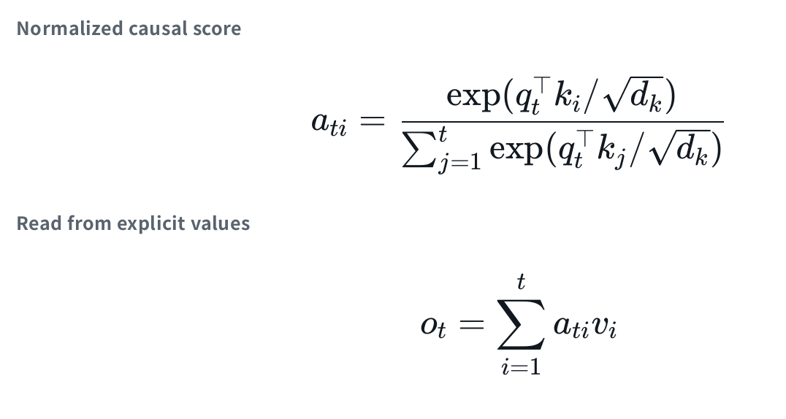
老生常谈了，最经典的注意力机制

| 符号                     | 理解                  |
| ---------------------- | ------------------- |
| $q_t$：当前位置的 Query      | 我现在需要找什么信息          |
| $k_i$：第 $i$ 个位置的 Key   | 这个位置有什么特征，是否与我的需求匹配 |
| $v_i$：第 $i$ 个位置的 Value | 如果关注这个位置，可以从它取出什么信息 |
延伸出来的还有sliding-window attention(属于sparse?)，只能看到固定窗口的上下文，可以降复杂度

### Linear attention {#linear-attention}
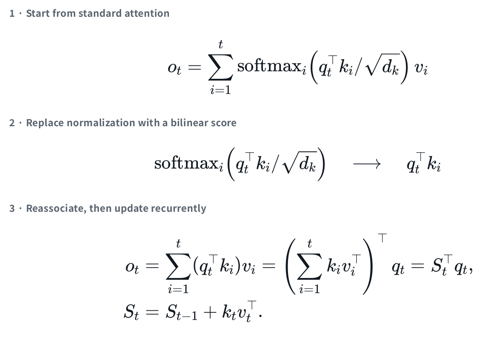​

$q$与$k$点积后不再做softmax的非线性变化，而是直接点积，那么运算就变成线性的了，可以不断更新记忆矩阵，那么这样解码的复杂度甚至是$O(1)$

代价是什么呢，丧失了softmax赋予的非线性选择能力,线性的输出会越来越大，需要引入归一化；如果有一个key写出了一个很weird的值，那么它将永远留在记忆中，无法擦除

### DeltaNet {#deltanet}
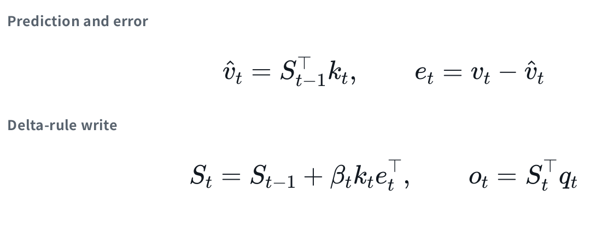
DeltaNet关注”如何遗忘“，用当前token的k查询记忆，得到一个信息，与已产生的v作差，对记忆进行修正。在通过修正后的记忆与当前的q，经过后续网络预测出下一个token。

### Gated DeltaNet {#gated-deltanet}
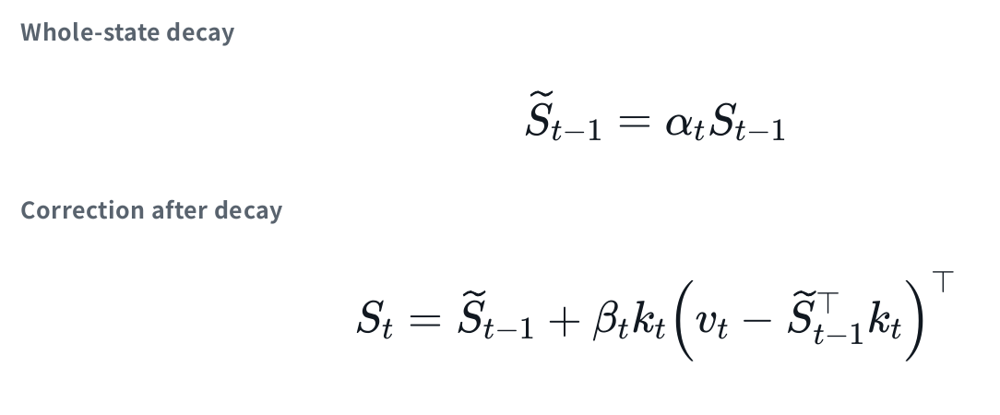
加上一个超参数$\alpha$，调整前面记忆的衰减程度

### Kimi Delta Attention   {#kimi-delta-attention}
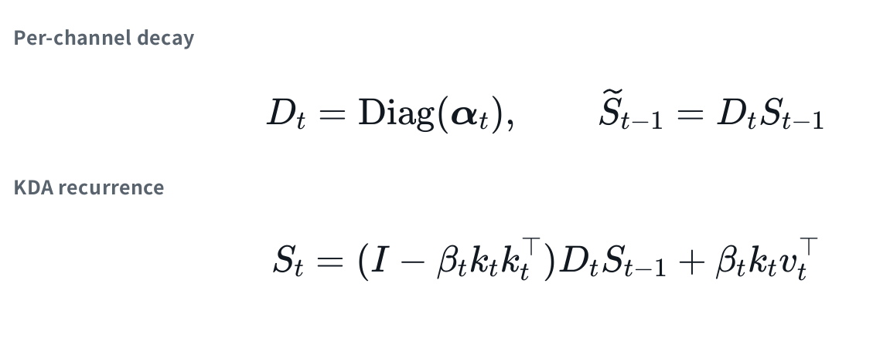
按通道的衰减率

!!! intro
    固定大小的状态无论怎么设计，都会在“需要精确复述第 3 轮某个文件第 40 行”这类任务上失败。状态适合承载“大意”和“已确认的结论”，不适合承载“原文”。全局层（稠密或稀疏）存在的意义，就是保留一条精确检索的通道。这就是为什么混合架构是必然的

### Sparse attention {#sparse-attention}
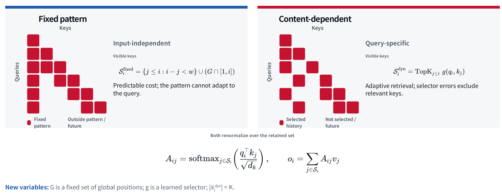
#### input-independent {#input-independent}
每个 query 查看一个局部窗口，以及一组固定的全局位置 $G$：

$$
\mathcal{S}_i^{\text{fixed}}
=
\{j \le i \mid i-j < w\}
\cup
\bigl(G \cap [1,i]\bigr)
$$

- **优点：**计算代价可预测，可以用一个 kernel 完成计算。
- **局限：**可见模式不会随 query 变化。关键证据若在窗口之外，且不属于 $G$，该 query 就无法看到它。

#### content-dependent {#content-dependent}

用廉价打分函数 $g(q_i,k_j)$ 对历史位置打分，例如先将 $Q$、$K$ 降维，再计算点积；然后取分数最高的 TopK 位置作为可见集合：

$$
\mathcal{S}_i^{\text{dyn}}
=
\operatorname{TopK}_{j \le i}\, g(q_i,k_j)
$$

最后，在选出的子集上计算完整的 Softmax 注意力。

内容相关版本更强大，能跟着 query 走；代价是**选择器可能选错**。TopK 是硬截断：相关 key 没进前 K 就等于不存在，没有回退机制。这与线性注意力的失败模式相反——后者“模糊地记住了一切”，前者“精确地漏掉了一个”。所以它通常用两阶段实现（先粗筛再精算）。

## Training Achitecture {#training-achitecture}

!!! tip
    这些更多可能是LLM basic课程的内容，一些数学细节可以忽略，主要关注agent视角下的观点

### Encoding {#encoding}
通过位置编码传递每个token的位置

#### Absolute positional encodings {#absolute-positional-encodings}

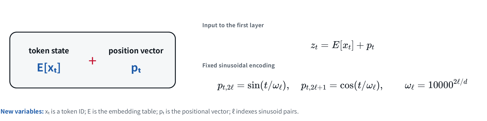

给每个位置一个向量，和 token embedding 直接相加：

$$
z_t=E[x_t]+p_t
$$

$E[x_t]$ 表示这个 token 的内容，$p_t$ 表示它在第几个位置。同一个词放在不同位置，加完位置向量后，送进模型的表示就不同了。位置在计算 Q、K、V 之前进入，因此会影响后续的注意力。

$p_t$ 可以是一张通过训练学到的表，也可以用固定的正弦、余弦函数生成：

$$
p_{t,2\ell}=\sin(t/\omega_\ell),\qquad
p_{t,2\ell+1}=\cos(t/\omega_\ell),\qquad
\omega_\ell=10000^{2\ell/d}
$$

先把每一对 sin、cos 理解成一只转速不同的钟：位置 $t$ 增大时，有的转得快，有的转得慢。把这些读数组合起来，就得到当前位置的表示。$\ell$ 是第几对维度，$d$ 是向量总维度。

#### Rotary position embeddings (RoPE) {#rotary-position-embeddings-rope}

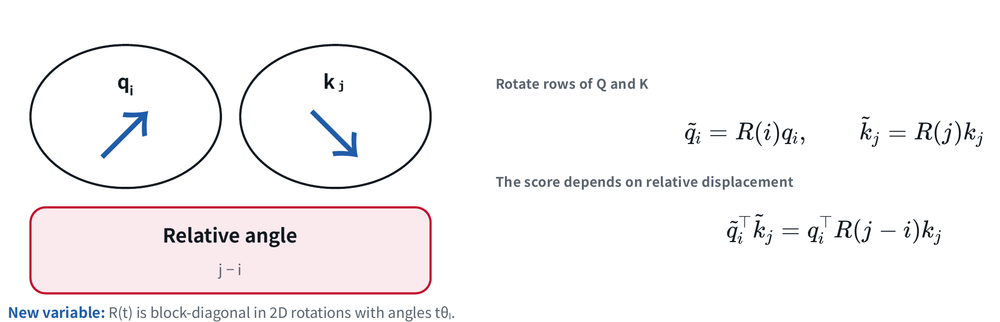

RoPE 把 Q、K 的向量维度两两分组，按照位置旋转；V 保持不变：

$$
\widetilde q_i=R(i)q_i,\qquad
\widetilde k_j=R(j)k_j
$$

$R(i)$ 表示位置 $i$ 对应的旋转。不同的维度对有不同的旋转速度。两个旋转后的向量做点积时：

$$
\widetilde q_i^\top\widetilde k_j
=q_i^\top R(j-i)k_j
$$

#### No positional encoding (NoPE) {#no-positional-encoding-nope}

NoPE 不添加显式的位置向量，也不做 RoPE 旋转，输入就是：

$$
z_t=E[x_t]
$$

那模型从哪里获得顺序信息？因果注意力中，不同位置能看到的前缀不同；递归模型中，当前状态又依赖之前的更新过程。这些计算结构可以提供顺序线索。

### Position interpolation {#position-interpolation}

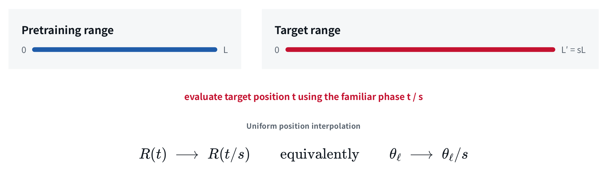

假设模型训练时的长度是 $L$，现在想扩展到 $L'=sL$。位置插值把位置 $t$ 换成 $t/s$：

$$
R(t)\longrightarrow R(t/s)
$$

也可以理解成每对维度的旋转频率都除以 $s$：

$$
\theta_\ell\longrightarrow\theta_\ell/s
$$

例如长度扩大到 4 倍，就把新位置编号都除以 4。扩展后的最远位置重新落回训练时的位置范围，相邻位置的间隔也从 1 变成了 $1/4$。

### YaRN {#yarn}

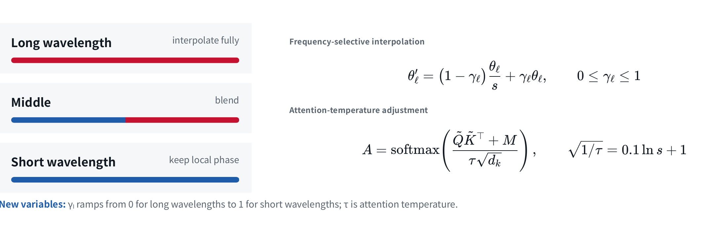

RoPE 不同维度的旋转频率不同，YaRN 就分别处理：

- 长波长、低频的维度做充分插值。
- 短波长、高频的维度保留原来的旋转频率，保留局部位置差别。
- 中间的维度在两种处理之间过渡。

$$
\theta'_\ell=(1-\gamma_\ell)\frac{\theta_\ell}{s}
+\gamma_\ell\theta_\ell,\qquad 0\leq\gamma_\ell\leq1
$$

$\gamma_\ell=0$ 时完全插值，$\gamma_\ell=1$ 时保持原频率。这个式子就是按比例混合两种频率。

YaRN 还调整 attention 的温度，控制 Softmax 权重的集中程度：

$$
A=\operatorname{softmax}\left(
\frac{\widetilde Q\widetilde K^\top+M}{\tau\sqrt{d_k}}
\right)
$$

经验关系是：

$$
\sqrt{1/\tau}=0.1\ln s+1
$$

### Context parallelism {#context-parallelism}

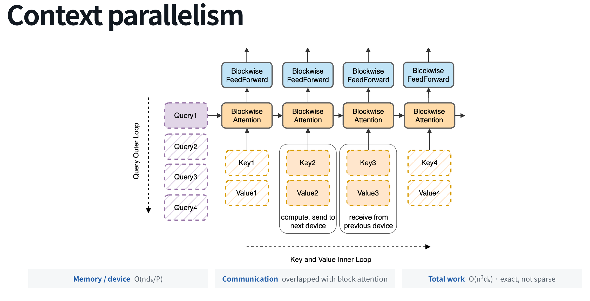

长序列还会遇到单张 GPU 放不下的问题。Context parallelism 沿序列维度把上下文分到 $P$ 台设备上。以 Ring Attention 为例，各设备持有一部分 Q，并交换 K、V 块，分块完成注意力计算，尽量让通信与计算重叠。

## Caching {#caching}

### KV compression {#kv-compression}
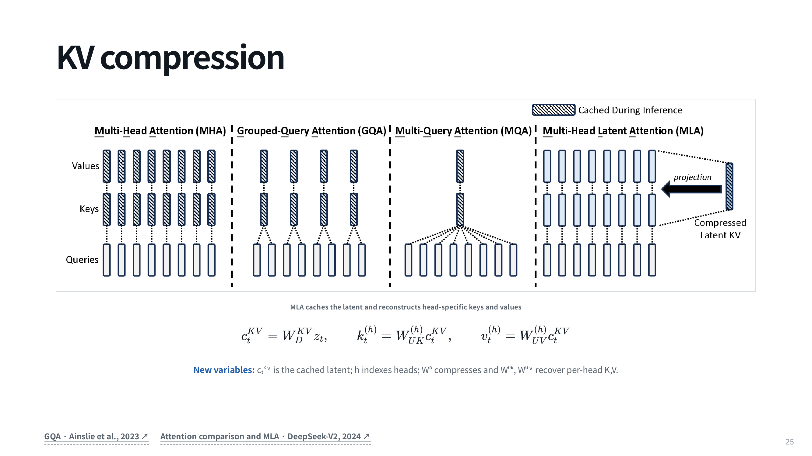
前三种减少 K、V 的份数，MLA 缓存低维隐向量 cₜᴷⱽ 并在使用时重建每个 head 的 K、V

### Prompt {#prompt}
这也是agent perspective的重要的一部分

稳定的指令、工具定义和示例放在前面，新用户消息与观察结果追加在后面。

常见的导致缓存命中率低的原因
- **每步改系统提示词**。最典型的错误是“把当前时间加到 system prompt 里
- **动态调整工具列表**。工具描述在 system 段
- **每步换模型**。
- **无意义的重排**

### allocation {#allocation}
这些更多关于infra，~~反正我好像没怎么懂~~
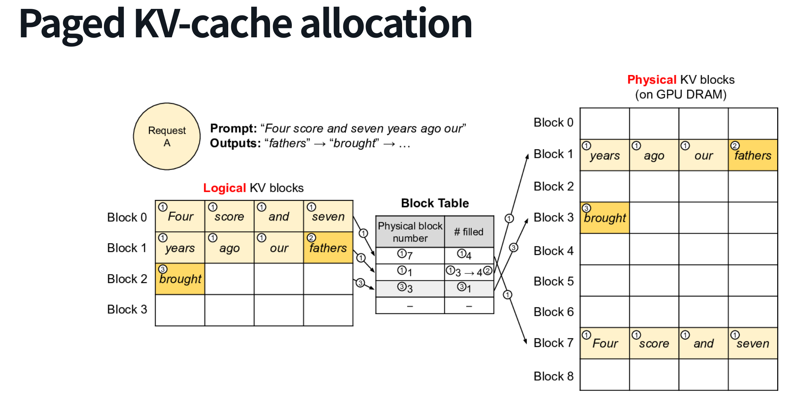

请求看到的是连续的逻辑位置，实际的块可以分散放在 GPU 显存中，通过 block table 查到地址，用多少就分配多少。

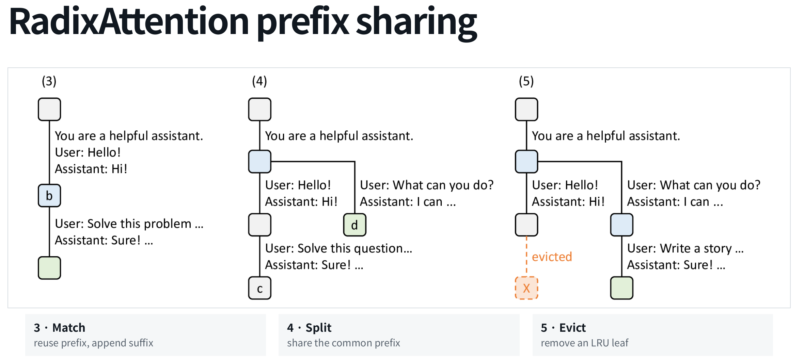

 把已缓存的前缀组织成 radix tree。新请求匹配已有前缀，共同部分共享，分歧处形成不同分支；空间不足时可以淘汰最近较少使用的叶子。它处理的是“哪些请求可以共用已经算好的状态”。

## Context compaction {#context-compaction}

上下文越来越长时，需要把旧历史整理成较短的工作状态。

设完整历史为 $H_t$，压缩结果为 $\hat s_t$，允许的 token 预算为 $B$：

$$
\hat s_t=\mathcal C(H_t;B),\qquad |\hat s_t|\leq B
$$

$\mathcal C$ 就是压缩器。它需要在预算内估计“任务现在进行到哪里”。进一步要求：

$$
p(A_{\mathrm{future}}\mid H_t)
\approx
p(A_{\mathrm{future}}\mid\hat s_t)
$$

直观上，换成压缩后的状态，agent 接下来做出的选择应该尽量接近读完全部历史时的选择。

失败？

触发条件可以是 token 阈值、提供商返回超出窗口的错误，或者用户手动要求压缩。阈值要为下一次输出预留空间。

### compaction drift {#compaction-drift}

`Use CUDA 12.4` → `Use CUDA 12.x` → `Use recent CUDA` → 约束消失

第 $k+1$ 次压缩往往是在上一份摘要上继续更新：

$$
\hat s_{k+1}=\mathcal C(\hat s_k\oplus R_k)
$$

版本号、用户明确提出的约束等锚点适合直接复制；最近正在处理的内容保留原文

## agent perspective {#agent-perspective}

模型架构决定历史以什么形式保留，训练决定模型能不能利用远处的证据。服务系统通过缓存复用已有计算，harness 则决定哪些观察进入上下文、哪些内容需要压缩或外置。
