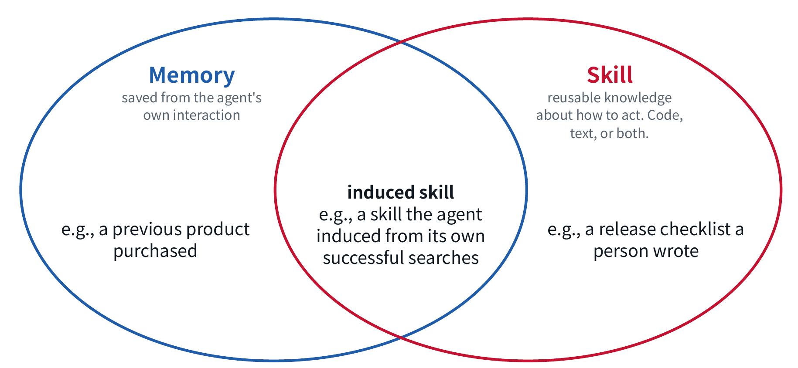
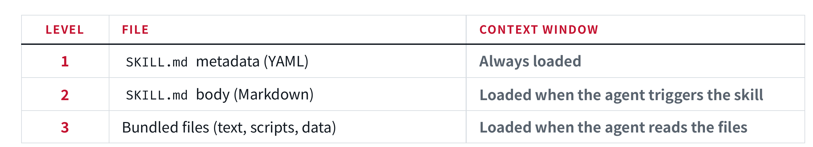
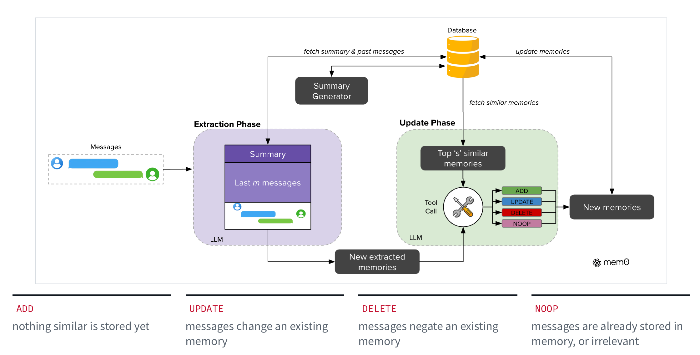
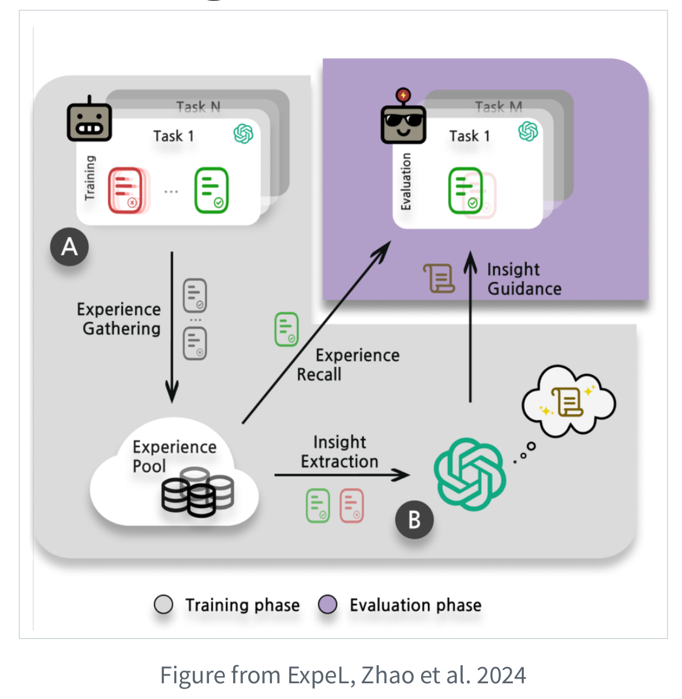
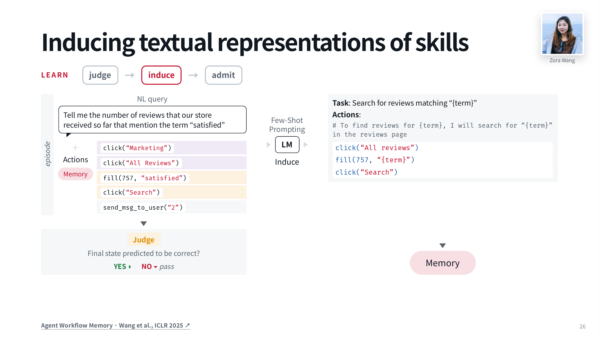
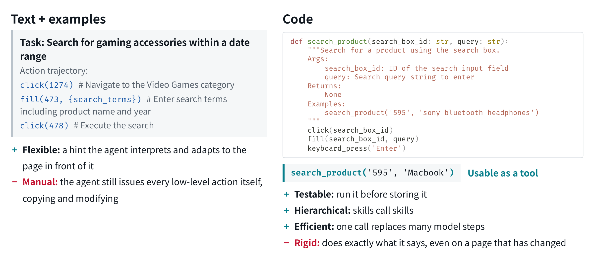
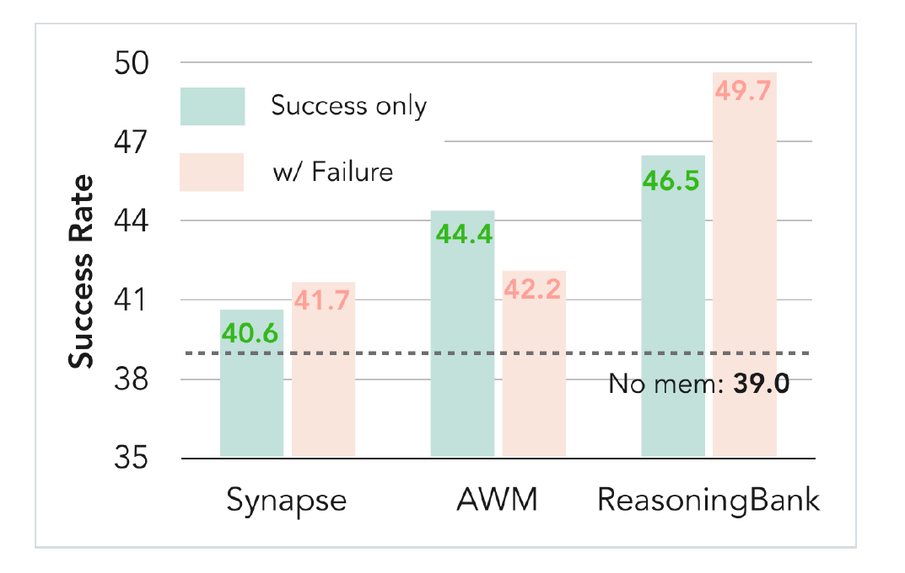
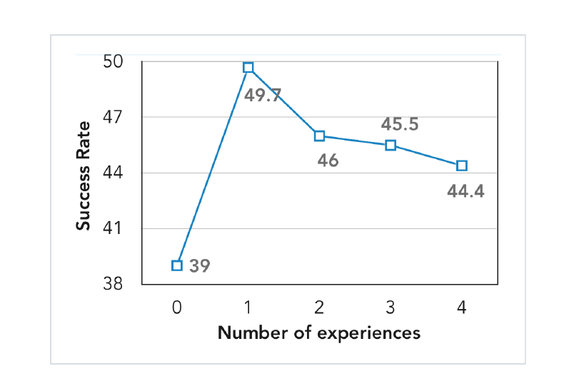
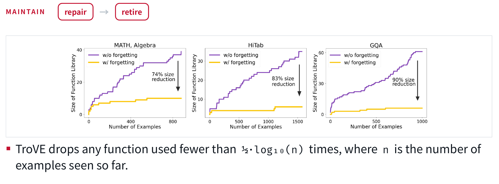
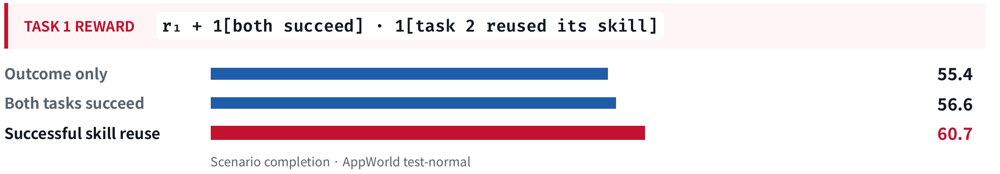

---
tags:
- skill
- memory
title: Skills and Memory
---
# Skills and Memory {#skills-and-memory}


!!! tip "Readings"
    - [OpenHands: How to Create Effective Agent Skills](https://www.openhands.dev/blog/20260227-creating-effective-agent-skills)
    - [SkillsBench](https://arxiv.org/abs/2602.12670)
    - [MemGPT](https://arxiv.org/abs/2310.08560)
    - [Agent Workflow Memory (AWM)](https://arxiv.org/abs/2409.07429)
    - [Agent Skill Induction (ASI)](https://arxiv.org/abs/2504.06821)
    - [ReasoningBank](https://arxiv.org/abs/2509.25140)


This lecture talks about `representation`, `induction` and `lifecycle` of skills. It's about a tradeoff on model steps and experience.

Agents have a lot of shared task structure, so how can we updating agents.

- context window: what lec03 covers
- external artifacts: what we focus this lec
- model weights: in SFL lec


Except for skill as instruction, we have another type of skills that is induced from agents' self experience.
## Authored skills {#authored-skills}
 throw an example
 ```txt
 my-skill/
├── SKILL.md          # Required: metadata + instructions
├── scripts/          # Optional: executable code
├── references/       # Optional: documentation
├── assets/           # Optional: templates, resources
└── ...               # Any additional files or directories
 ```
not all files will be read in one task, we use `progressive disclosure` as a strategy. in the process, agents load skills with tools: register the index of skills in the system prompt; model evaluates whether to load a certain skill; skill content as tool result



so questions raised:
- why markdown
- the trigger threshold of progressive disclosure

## Memories {#memories}
### Mem0 {#mem0}


For every new messages, LLM extract facts from it, then retrieval embedding vector from database, decide what operation to apply.

The idea is similar in [DeltaNet](lec03.md#deltanet): linear attention only append, but delta will first retrieval values related to present query and change them. In agents' situation, it's tricky, because memory is related to time, source, workspace...

### Similar-trajectory conditioning {#similar-trajectory-conditioning}


like an agent's RAG: collect all trajectories with natural language as feedback, store them in the data pool. also use embedding Top-K, insert similar ones in the context.

cons: context is too long, similar is not equivalent to useful


!!! idea
    the two ways to manage memories above rely on judgements, so if `jev model` is useful on this domain


## Inducing skills {#inducing-skills}

### Finding the reusable part {#finding-the-reusable-part}

I can think of skill induction as extracting a subroutine from experience. The product and the final goal change, but the search procedure can be reused.

This also helps separate an episode from a skill. An episode preserves what happened in one run. A skill abstracts the part that may work again, with task-specific values replaced by parameters.

Some earlier systems approach this through program induction. `Voyager` builds a library of Minecraft functions that can call earlier functions. `DreamCoder` learns abstractions that compress solved programs; `Stitch` searches for shared structure in a program corpus. I find the compression view useful: repeated code suggests a possible abstraction.


### AWM {#awm}



Agent Workflow Memory (AWM) extracts workflows from successful interaction traces. A reusable workflow replaces that word with `{term}` and keeps the actions needed to search the reviews.

The induction prompt asks for repeated subroutines, avoids overlapping workflows, and replaces variable parts with descriptive names. The resulting text can guide another task, and later workflows can build on what is already in memory.


### Text or code? {#text-or-code}




A code skill can turn several low-level actions into one model-issued call. It is also possible to test the function before storing it. The tradeoff is that execution follows the code exactly. If the page changes, a previously useful function may keep trying the wrong interaction.

Code as skill, it's same as a tool? 
tool is more like an interface; skill is a way to solve a certain task, combining tools

### PolySkill {#polyskill}
`PolySkill` addresses this with a shared interface and different implementations. Higher-level compositions call abstract methods; each website implements the primitive browser actions. 


!!! idea
    PolySkill makes a function more flexible and could be generated, it's structure inspired: markdown could be flexible, can we organize it in a more code-like structure? 


## The skill lifecycle {#the-skill-lifecycle}

### ReasoningBank {#reasoningbank}



`ReasoningBank` learn strategies from failure, not trajectories or workflow

find that the method become more abstract


!!! idea
    so more abstract layer will be what? meta strategies(how to choose strategies) or ...


And, the capability of judging whether fails or not also matters

### Retrieval cost {#retrieval-cost}



Too much experience lead to decrease, because not related or the context is too long. this problem also happens in `Skill bench`(authored skills)

### Consolidation and retirement {#consolidation-and-retirement}

A growing library needs maintenance. Skills can overlap, stop working, or interfere with tasks outside their intended scope. 


`TroVE` uses a concrete frequency rule: it drops a function used fewer than


$$
\frac{1}{2}\log_{10}(n)
$$


times, where $n$ is the number of examples seen so far. 

if the number of skills is too large, we can even create a "skill-search" tool

## Training the skill inducer {#training-the-skill-inducer}



skill is about future

`SAGE`-- puts two related tasks in one rollout so that training can reward successful reuse. The reward shown for the first task is:


$$
r_1 + \mathbf{1}[\text{both tasks succeed}]
\cdot \mathbf{1}[\text{task 2 reused the skill}].
$$


The extra reward depends on both outcomes and reuse. A skill that merely gets written or called does not satisfy the full condition.

`AgeMem` also brings later memory use into training through a long trajectory.
