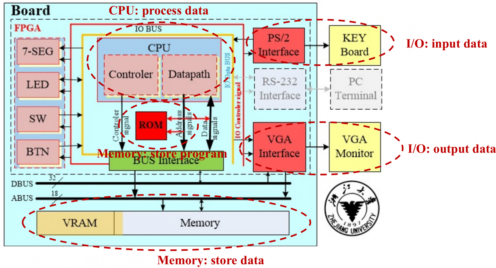
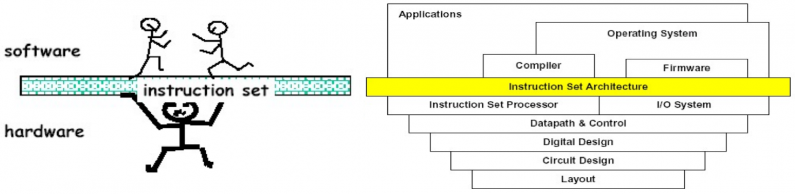
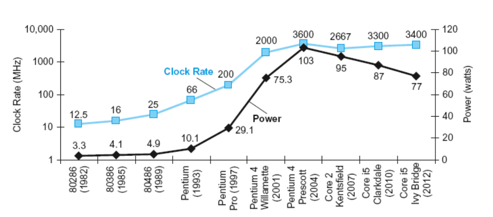
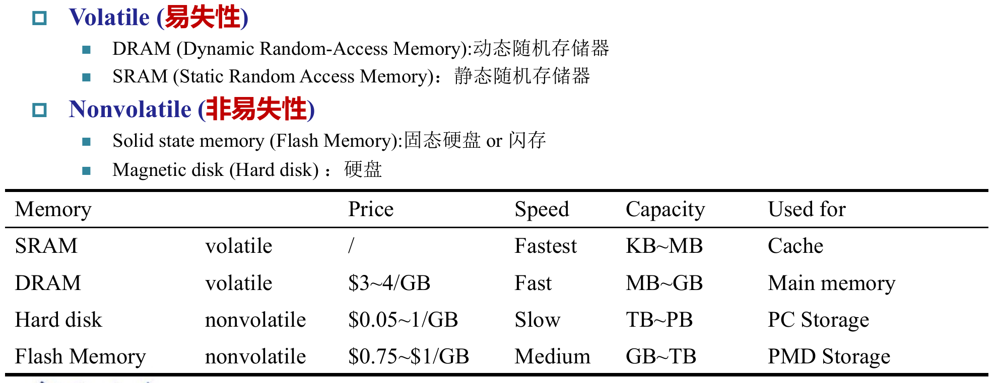
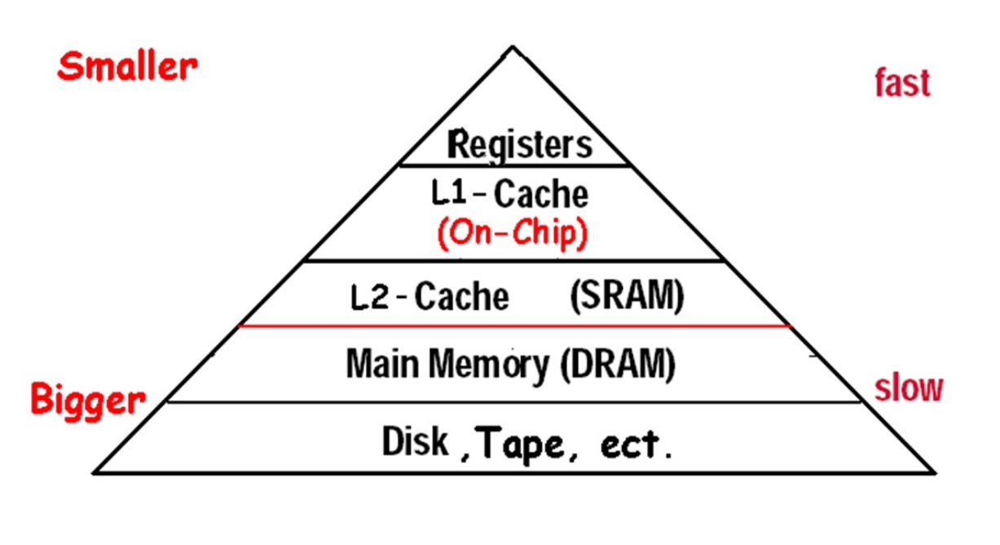
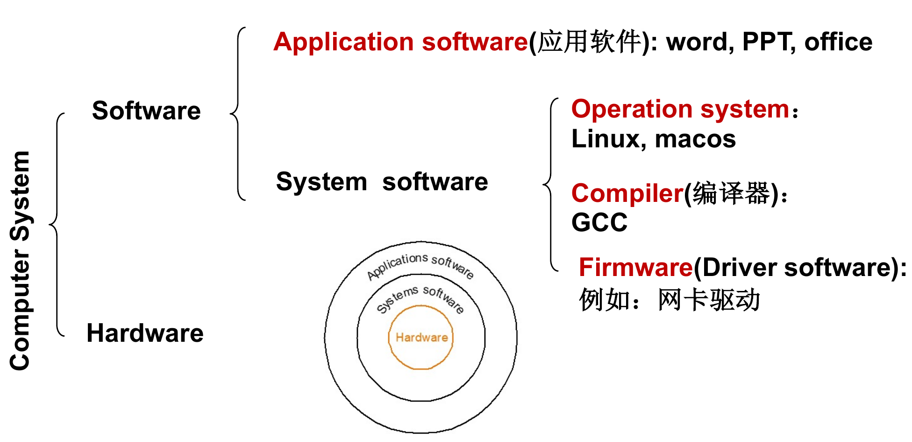

---
tags:
- performance-analysis
- computer-organization
- Turing-machine
source: https://mem.ac/course/co/note/1/
title: 01-Prelude
---
## 1. Introduction to Computer {#1-introduction-to-computer}

### 1.1. Computer Organization {#11-computer-organization}

-   **计算机系统(computer system)**
    -   **软件(software)**
    -   **硬件(hardware)**
        -   CPU
            -   **控制单元(control unit)**
            -   **数据通路(datapath)**
                -   Path: multiplexor
                -   ALU: adder, multiplier
                -   Registers
                -   ......
        -   **内存(memory)**
        -   I/O **接口(interface)**
            -   Input: keyboard, mouse
            -   Bidirectional: RS-232、USB
            -   Output: VGA、LCD

{ width="511" }

这个就是本课程实验部分大致的原理图。

#### 1.1.1. Instruction Set {#111-instruction-set}

**指令集(instruction set)** 是连通软件和硬件之间的桥梁，我们将在 Chapter 2 中重点介绍这一部分。

{ width="762" }

## 2. Performance Measurement {#2-performance-measurement}

-   **响应时间(response time)** / **执行时间(execution time)**：完成一个任务所花费的时间。
-   **吞吐率(throughput)** / **带宽(bandwidth)**：单位时间内完成的任务数量。

在本章节或者后面的章节中，我们可能会关注处理器的性能或改进前后的 **性能提升(speedup)**。

-   **性能(performance)**：执行时间的倒数。$\text{Performance}_X = \dfrac{1}{\text{Execution time}_X}$。

-   **相对性能(relative performance)**：$X$ 比 $Y$ 快了几倍（$X$ is $n$ times faster than $Y$）$n=\dfrac{\text{Performance}_X}{\text{Performance}_Y} = \dfrac{\text{Execution time}_Y}{\text{Execution time}_X}$.

-   **持续时间(elapsed time)**：从任务开始到任务结束所花费的时间。

-   **CPU 时间(CPU time)**：该任务占用 CPU 的时间。

    -   **用户 CPU 时间(user CPU time)**：用户态的程序在 CPU 上运行的时间。
    -   **系统 CPU 时间(system CPU time)**：内核态的程序在 CPU 上运行的时间。

当我们衡量一条指令的 CPU 时间时：

-   **时钟周期(clock period / clock cycle time)**：一个 **时钟循环(clock cycle)** 的持续时间。

    -   e.g. $250 \text{ ps} = 0.25 \text{ ns} = 2.50 \times 10^{-10} \text{ s}$

-   **时钟频率(clock rate / clock frequency)**：一秒内的时钟周期数。$\text{clock rate} = \dfrac{1}{\text{clock cycle time}}$。

    -   e.g. $4 \text{ GHz} = 4000 \text{ MHz} = 4 \times 10^9 \text{ Hz}$

-   **时钟周期数(clock cycles)**：程序所需要的周期数。


    $$
\displaystyle{\begin{aligned}
  \text{CPU time} &= \text{CPU clock cycles} \times \text{clock cycle time} \\
  &= \frac{\text{CPU clock cycles}}{\text{clock rate}}
\end{aligned}}
$$


-   **指令数(instruction count, IC)**：任务执行了多少条指令。

-   **周期数(clock cycles per instruction, CPI)**：每条指令所需要的周期数量。一般 CPI 直接指 **平均周期数(average clock cycles per instruction, Avg. CPI)**，即所有指令的周期数的平均值。CPI 是由硬件实现决定的，在第四章会进一步讲到。

对于一个指令数为 $\text{IC}$ 的程序，其：


$$
\begin{aligned}
    \text{clock cycles} &= \text{IC} \times \text{CPI} \\
    \text{CPU time} &= \text{IC} \times \text{CPI} \times \text{clock cycle time} = \dfrac{\text{IC} \times \text{CPI}}{\text{clock rate}}
\end{aligned}
$$


### 2.1. Three Walls {#21-three-walls}

-   Power Wall：主频提高了很多，但功耗并没有得到这么多的提升，因为我们降低了工作电压 (5V-1V)。现在工作电压不能再降低了（否则泄漏电流占比太大），因此我们不能再提高功率了。以 CMOS IC technology 为例，其**能耗(power)** 公式为：（**电容负载(capacitive load)**）


$$
\text{Power} = \text{Capacitive load} \times \text{Voltage}^2 \times \text{Frequency}
$$


{ width="529" }

-   Memory Wall：Memory 的性能增长不如 CPU 的性能增长，大部分时间花在读写内存了。

-   ITP Wall：难以在单个进程的指令流中找到足够的并行性，以使性能更高的处理器核心保持忙碌。

### 2.2. MIPS {#22-mips}

**百万指令数每秒(Millions of Instructions Per Second, MIPS)**：


$$
\begin{aligned}
\text{MIPS} &= \dfrac{\text{Instruction Count}}{\text{Execution Time} \times 10^{6}}\\
&= \dfrac{\text{Instruction Count}}{\dfrac{\text{Instruction Count} \times \text{CPI}}{\text{Clock Rate}} \times 10^{6}}\\
&= \dfrac{\text{Clock Rate}}{\text{CPI} \times 10^{6}}
\end{aligned}
$$


但注意，只有在其他参数一致时 MIPS 才有比较意义，不同的 ISA 之间不能仅凭 MIPS 比较。

### 2.3. Pitfall: Amdahl's Law {#23-pitfall-amdahls-law}

**阿姆达尔定律(Amdahl's Law)** 用于计算系统某一部分性能提升后对整体性能的影响。它指出，系统整体性能的提升受限于系统中未被改进部分的性能。


$$
T_{\text{improved}} = \frac{T_{\text{affected}}}{\text{improvement factor}} + T_{\text{unaffected}}
$$


-   推论：make the common case fast

-   注意：不是说 MIPS 越高性能就越好，因为 MIPS 没有考虑指令的复杂程度等等（如精简指令集 vs 复杂指令集）。MIPS 往往是用来描述同一个处理器或者同一个指令集对于任务的优化。

## 3. Eight Great Ideas {#3-eight-great-ideas}

计算机组成与设计中的八大重要思想。

### 3.1. Design for Moore's Law {#31-design-for-moores-law}

设计紧跟摩尔定律。


???+ important "**摩尔定律(Moore's Law)**"

    Integrated circuit resources double every 18-24 months. 单芯片上所集成的晶体管资源每 18 至 24 个月翻一番。


-   Design for where it will be when finishes rather than design for where it starts.

### 3.2. Use Abstraction to Simplify Design {#32-use-abstraction-to-simplify-design}

通过抽象化来简化设计，使设计更易于理解和管理。

-   采用层次化、模块化的设计。

### 3.3. Make the Common Case Fast {#33-make-the-common-case-fast}

加速大概率事件。

-   如部分指令集设计中的 0 号寄存器。

### 3.4. Performance via Parallelism {#34-performance-via-parallelism}

通过并行提升性能。

### 3.5. Performance via Pipelining {#35-performance-via-pipelining}

通过流水线提升性能。

-   换句话说就是，每个流程同时进行，只不过每一个流程工作的对象是时间上相邻的若干产品；
-   相比于等一个产品完全生产完再开始下一个产品的生产，会快很多；
-   希望每一个流程的时间是相对均匀的；

### 3.6. Performance via Prediction {#36-performance-via-prediction}

通过预测提高性能。

-   例如先当作  `if()`  条件成立，执行完内部内容，如果后来发现确实成立，那么直接 apply，否则就再重新正常做。
-   这么做就好在（又或者说只有这种情况适合预测），预测成功了就加速了，预测失败了纠正的成本也不高。

### 3.7. Hierarchy of Memories {#37-hierarchy-of-memories}

不同类型的存储器具有不同的速度和容量，不同层次使用不同类型的存储器以提高性能并节约成本。

-   Disk / Tape -> Main Memory(DRAM) -> L2-Cache(SRAM) -> L1-Cache(On-Chip) -> Registers

### 3.8. Dependability via Redundancy {#38-dependability-via-redundancy}

通过冗余设计来提高系统的可靠性，确保单点故障不会导致系统崩溃。

-   类似于卡车的多个轮胎，一个模块 down 了以后不会剧烈影响整个系统；

---

## Turing Complete {#turing-complete}
Turing complete指的是：一种计算系统在时间和存储空间足够的理想条件下，能够执行任何可用算法完成的计算。

这样的定义似乎过于模糊，更加严格来说，我们可以定义图灵机：


$$
\delta: Q\times\Gamma
\longrightarrow Q\times\Gamma\times\{L,R\}
$$


其中 $Q$ 是状态集合，$\Gamma$ 是纸带符号集合。这表示：

> 根据“当前状态”和“当前读到的符号”，确定“下一个状态”“写入的符号”和“读写头移动方向”。


**一个计算系统 $S$ 是图灵完备的，当且仅当它能够模拟任意图灵机的计算**。

对于任意图灵机 $M$，都可以在 $S$ 中构造一个程序 $P_M$，使得对于任意输入 $x$：

- 如果 $M$ 在 $x$ 上停机并输出 $y$，那么 $P_M$ 也停机并输出对应的 $y$；
- 如果 $M$ 在 $x$ 上不停机，那么 $P_M$ 也不停机。

即：


$$
\boxed{\text{图灵机可计算的所有部分函数}
\ \subseteq\
\text{系统 }S\text{ 可计算的部分函数}}
$$


## circuit history {#circuit-history}
稍微简化的理解


$$
\text{电子管计算机}
\rightarrow
\text{晶体管计算机}
\rightarrow
\text{集成电路计算机}
$$


从金属管到半导体到半导体芯片

## Register width {#register-width}
即我们常说的”32位CPU“，指的是机器字长或是通用寄存器宽度为32bit

本课程使用32位

## Advanced Coding Language {#advanced-coding-language}
其实我也很疑惑，像是python这样的语言究竟是怎么创造出来的

先介绍一下python，它是一种解释型语言，不同于，C语言通过编译器转化成汇编语言，再转化成机器码，python的过程大概是这样的

源代码 → 字节码 → Python 虚拟机执行

这使它更容易反复执行、动态行为等等

它的”解释器“实则由C语言实现，而C语言的编译器由其他更早的语言实现，逐步追溯到最开始
```text
直接编写机器码
    ↓ 做出最初的工具
用机器码实现汇编器
    ↓ 可以用汇编写程序
用汇编等已有工具实现高级语言编译器
    ↓
用已有高级语言开发更多语言工具
```
## ISA {#isa}
Instruction Set Architecture，指令集体系结构 是软件与处理器硬件之间的接口规范

比如intelMac使用x86，而apple芯片使用ARM
这让我联想到编译intel版的Celemod的经历，源码是开发者编写的程序文本，而我需要通过源码完成intel版本的编译。

你会想：只要我有相应的编译器就可以处理了，但是，如果有些依赖只支持特定的ISA，那么移植就会有难度

## Memory in CPU {#memory-in-cpu}


ROM是只读存储器，用来保存不需要经常修改、断电后仍要保留的内容

|类型|断电后数据|典型用途|主要特点|
|---|---|---|---|
|SRAM，静态 RAM|丢失|CPU 缓存 Cache|快，单位容量成本高|
|DRAM，动态 RAM|丢失|主存|比 SRAM 慢，但适合做较大容量|
|Flash，闪存|保留|SSD、手机存储|用于长期保存数据|
|Magnetic disk，磁盘|保留|机械硬盘 HDD|访问较慢，适合大容量存储|
可以发现，我们常说的”16G内存“指的应该是DRAM



## software {#software}

如果没有操作系统，App 依赖的服务就不存在，通常不能直接运行。

但可以专门编写一个**直接在硬件上运行的程序**，自行处理硬件初始化、输入输出等工作，这叫**裸机程序（bare-metal program）**。一些简单的单片机程序就是这样运行的。CPU 本身只负责执行指令，并不要求必须先有操作系统。

驱动程序（driver）就是负责控制某类具体硬件的软件，属于系统软件。
