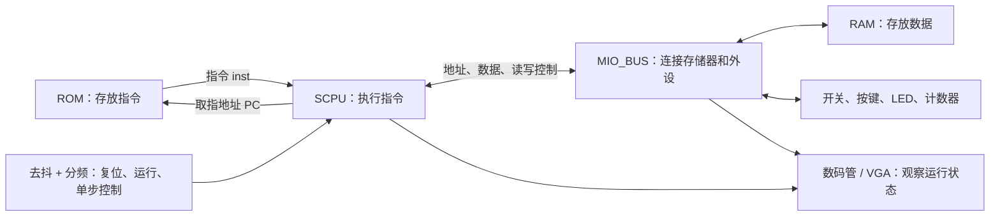

---
tags:
- CPU
title: IP核集成SOC设计
---
# IP核集成SOC设计 {#ip核集成soc设计}

本实验你将扮演一个乐高拼装大师，将11个模块拼装在一起，即编写顶层文件，最后拼成一个CPU

各模块关系：



大致分成两类，一类是计算机运行路径，一类是调试路径。
前者CPU 从 ROM 取指令，执行运算，通过总线读写 RAM 或外设。后者用开关控制 CPU 的执行速度，再把 PC、当前指令、数据地址等信号显示出来，让你看见 CPU 正在做什么。

当然，为了11个模块的更加具体，下面给出一个codex生成的表格：

| 模块                | 作用             | 重点                      |
| ----------------- | -------------- | ----------------------- |
| U1 `SCPU`         | 执行指令           | 本次调用提供的核，弄清输入输出         |
| U2 ROM            | 存放程序           | 用 `.coe` 初始化；PC 决定取哪条指令 |
| U3 `RAM_B`        | 存放数据           | 地址、写使能、写入数据、读出数据        |
| U4 `MIO_BUS`      | 连接 CPU、RAM 和外设 | 根据地址选择访问对象              |
| U5 `Multi_8CH32`  | 选择待显示的信号       | 用 `SW[7:5]` 切换八个显示通道    |
| U6 `Seg7_Dev`     | 驱动数码管          | 将 32 位数据显示为八位十六进制数      |
| U7 `SPIO`         | LED 接口及计数器控制   | 接收总线写入的数据               |
| U8 `clk_div`      | 分频、选择 CPU 时钟   | 自动运行和手动单步               |
| U9 `SAnti_jitter` | 开关、按键去抖        | 避免一次拨动产生多次跳变            |
| U10 `Counter_x`   | 通用计数器          | 作为外设，也可显示计数状态           |
| U11 VGA           | 显示调试信息         | 同时观察 PC、指令、ALU 结果等      |
~~依旧codex说明的~~项目结构：

```text
OExp02-IP2SOC/
├── OExp02-IP2SOC.xpr
├── A7.xdc
├── I_mem.coe
├── font_8x16.mem
├── vga_debugger.mem
├── IP/                          学生包提供的模块
│   ├── 9 组 .v + .edf
│   ├── Seg7_Dev/                数码管源码及封装工程
│   └── VGA/                     VGA 源码工程
├── OExp02-IP2SOC.srcs/           主工程源文件与 IP 配置
│   └── sources_1/ip/
│       ├── ROM_D/ROM_D.xci
│       └── Seg7_Dev_0/Seg7_Dev_0.xci
├── OExp02-IP2SOC.gen/            根据 IP 配置生成的代码
├── OExp02-IP2SOC.ip_user_files/  IP 配套文件和仿真脚本
├── OExp02-IP2SOC.cache/          缓存
├── OExp02-IP2SOC.hw/             硬件管理相关状态
└── OExp02-IP2SOC.sim/            仿真工作目录，目前为空
```

解释一下其中的一些文件，`.edf`是综合好的电路实现，它和给出的空模板`.v`配套（它告诉你怎么调用模块）。而IP封装后生成的`.veo`也是告诉你如何调用的。至于这两种方法有什么区别（？
`coe`是用来初始化memory的


让我们跳过繁琐的连线环节，最终上板
先将时钟调到我们想要的运行模式。三位开关控制着8个显示的数。可以观察，手动控制时钟，SCPU通过地址，读取ROM中的8位16进制（32位，所以地址是4字节跳动的）机器码，然后ALU运算，再RAM读写，数据总线是`MIO_BUS`。

你可以在[这里](https://venus.cs61c.org) 查看RISC-V的机器码意义，并输入汇编程序，运行过程中观察寄存器的状态

到最后，我才发现我不明白，实验名称的`SOC`是什么意思：SoC（System on Chip，片上系统）的特点，是把一个计算机系统需要的多个部件集成在同一块芯片中。对比工业上CPU的生产方法，相当于是利用现有的资源，而后者则是为目标设计制造电路。

还留了一个坑，就是这些模块的内部逻辑该怎么写，可能后面的实验会逐步推进。
