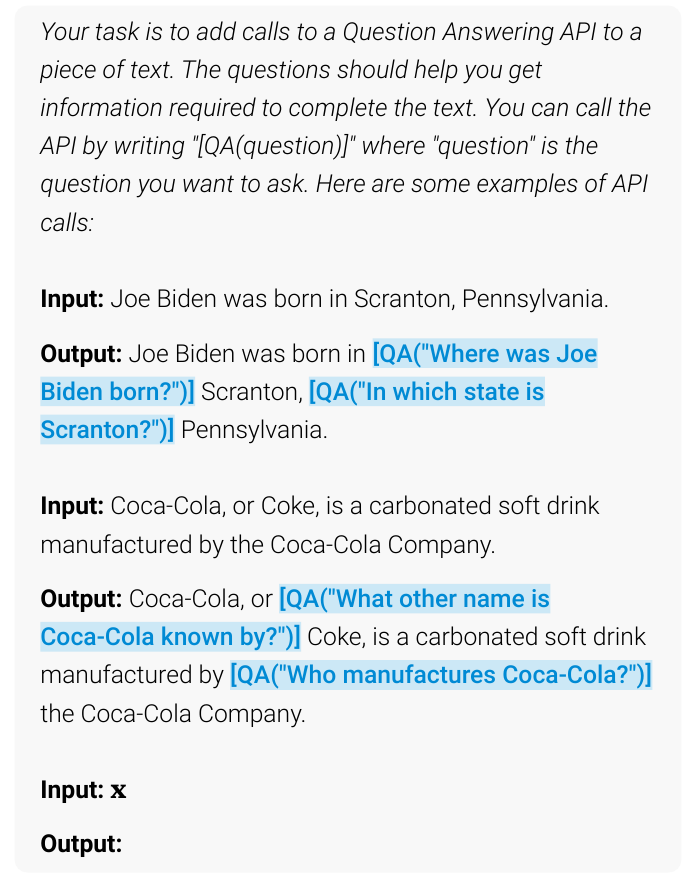
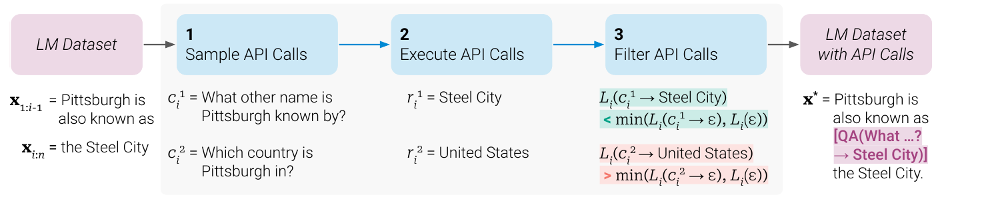
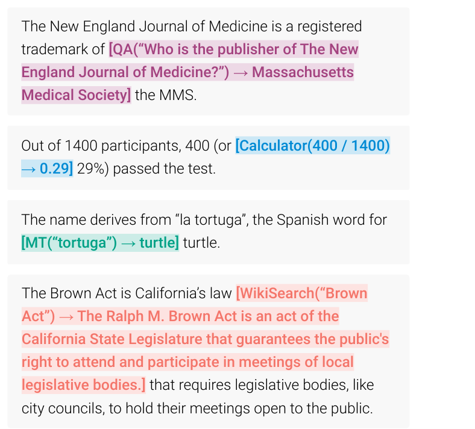
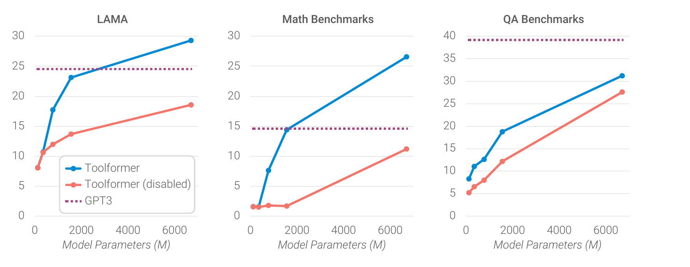

---
tags:
- tool-call
title: Language Models Can Teach Themselves to Use Tools
---
# Language Models Can Teach Themselves to Use Tools {#language-models-can-teach-themselves-to-use-tools}

!!! info
    **Title**: Toolformer: Language Models Can Teach Themselves to Use Tools
    **Authors**: Timo Schick et al.
    **First submitted**: 2023-02-09
    **Subject**: Computation and Language (cs.CL)
    **arXiv ID**: 2302.04761
    **Links**: [arXiv](https://arxiv.org/abs/2302.04761) · [PDF](https://arxiv.org/pdf/2302.04761)

## Background {#background}
> “LMs, paradoxically, struggle with basic functionality, such as arithmetic or factual lookup, where much simpler and smaller models excel.” 

鉴于大语言模型的基础原理是基于训练文本预测下一个token，所以当一个任务带有`工具性`而非`经验性`(我的感受：语料中几乎不会出现，但是如果会使用工具会变得很简单)，一个广为人知的例子是`strawberry`中r的数量，它们会出错。

值得注意的是，这里的`smaller model`并不能理解为参数量更小的语言模型，而是专为某一些任务而设计的“模型”，比如`calculator`，它甚至可以只是一个python脚本。

## Approach {#approach}
为不依赖于大量人类撰写的注释、让工具调用不局限于task，论文介绍了一种新的范式——Toolformer

>“Our aim is to equip a language model M with the ability to use different tools by means of API calls.” 

首先，要训练模型嵌入API call的能力

$$
\begin{aligned}
e(c) &= \texttt{<API>}\,a_c\texttt{(}i_c\texttt{)}\,\texttt{</API>} \\
e(c,r) &= \texttt{<API>}\,a_c\texttt{(}i_c\texttt{)}
\rightarrow r\,\texttt{</API>}
\end{aligned}
$$

我们会给出一些人类编写的带有API的示例供模型学习
API被当做一个特殊的token参与注意力机制

$$
p_i = p_M\!\left(
\texttt{<API>} \mid P(\mathbf{x}), x_{1:i-1}
\right)
$$

但是此时模型嵌入的API良莠不齐，进行筛选

$$
L_i(\mathbf{z})
=
-\sum_{j=i}^{n}
w_{j-i}
\log p_M\!\left(
x_j \mid \mathbf{z}, x_{1:j-1}
\right)
$$

表示在$z$前缀下的交叉损失熵

比较

$$
\begin{aligned}
L_i^+ &= L_i\!\left(e(c_i,r_i)\right), \\
L_i^- &= \min\!\left(
L_i(\varepsilon),
L_i\!\left(e(c_i,\varepsilon)\right)
\right)
\end{aligned}
$$

若

$$
L_i^- - L_i^+ \geq \tau_f
$$

则可以认为，该API调用的输入和输出都有助于模型的输出，这个API call是有效的

!!! question
    这是我刚开始读的疑问：从最开始看，LLM是基于internet中大量的文本信息所训练出来的，所以它的预测性在我看来十分“原生”，而toolformer这样的范式只是相当于给LLM一些prompt作为示例。并没有很好地训练模型“提出API“的能力，而论文中approach的部分只是在介绍如何从模型提出的API call挑选出优质的部分，可以这样理解吗？

确实有一些局限，但是这只是影响原有候选的覆盖率问题，toolformer确实可以通过自监督训练来学习提出API call的能力，后续的增强微调也会输入大量文本训练

## Tools {#tools}
Question Answering
Calculator
Wikipedia Search
Machine Translation
Calendar

## Experiments {#experiments}
取权重序列

$$
\begin{aligned}
w_t &= \frac{\widetilde{w}_t}
{\displaystyle\sum_{s\in\mathbb{N}}\widetilde{w}_s}, \\
\widetilde{w}_t &= \max(0,\,1-0.2t)
\end{aligned}
$$

它会重视近的位置，并截断较远位置。为什么使用线性，论文也并没有进行消融实验

几个有趣的点

- 在QA的实验中，Toolformer使用Wikipedia调用，并没有比GPT-3表现要好。一个原因是搜索结果可能不相关，而模型无法继续改写查询、翻找其他结果——每题只有一次调用机会。

future work:
> This is likely due to both the simplicity of our search engine (in many cases, it returns results that are clearly not a good match for a given query) and the inability of Toolformer to interact with it, e.g., by reformulating its query if results are not helpful or by browsing through multiple of the top results.

- 在Temporal Datasets中，日历的调用率仅有0.2%，这也暴露了工具链的限制：理想情况下可以先查询日期，再查询该日期对应的事实，但当前设置每题最多一次调用。

> e.g., Cristiano Ronaldo plays for ___

- scaling

较小模型可能无法完全利用所有工具

- 将模型调用的结果与人类判断相比较：损失下降并不代表它更有用，可能暴露出它与“语义上真正有用”之间存在偏差

## Future {#future}
toolformer作为三年前的论文，产生工具调用的方法可能有些“原始”，但是它作为一种方法第一次使用了自监督学习产生tool calling，现在的agent使用SFT+RL的比较多

Toolformer 可以理解为一种特殊的工具学习数据构造与微调方案；轨迹 SFT 改变了示范的组织方式，RL 则改变了行为的评价和优化方式。
